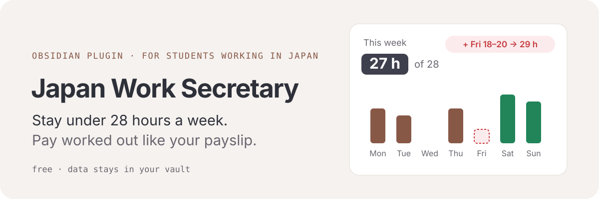
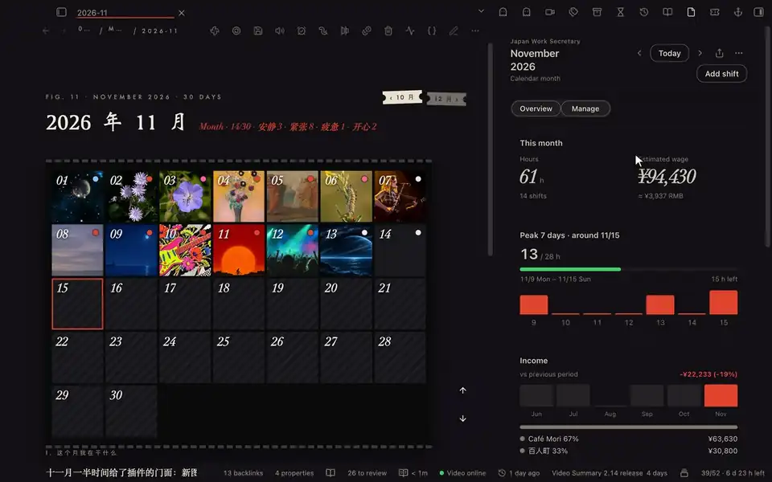
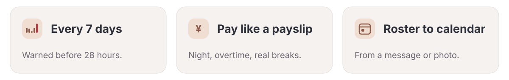
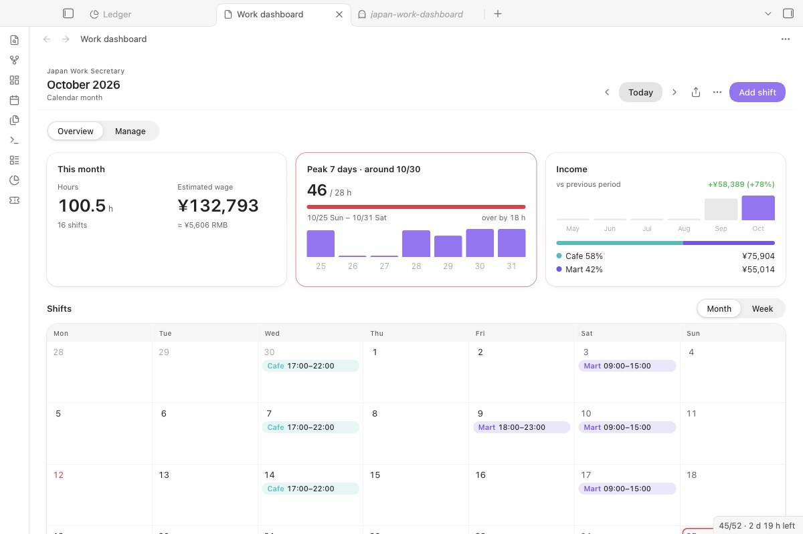
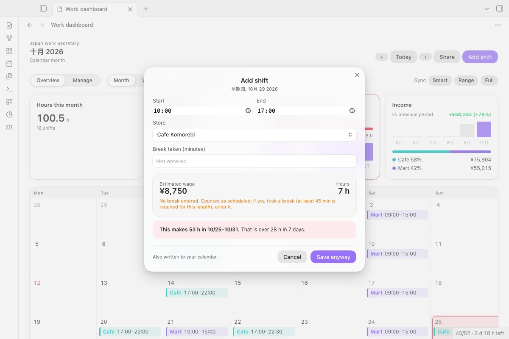
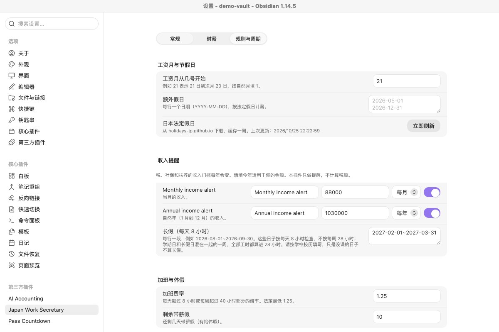
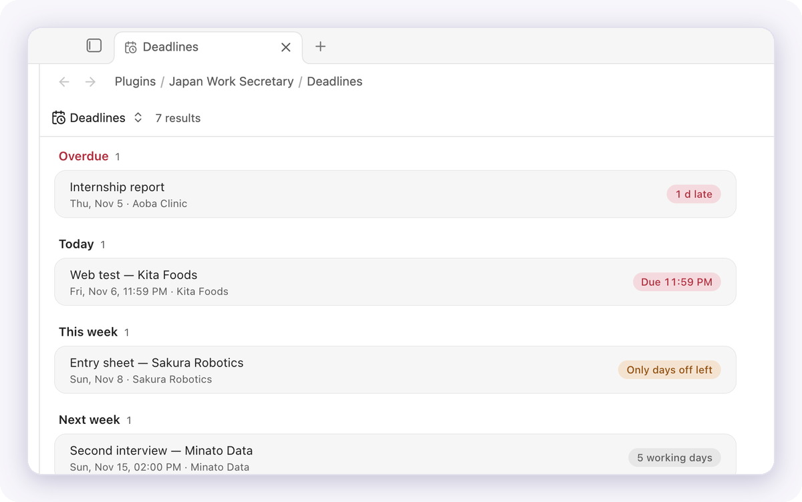
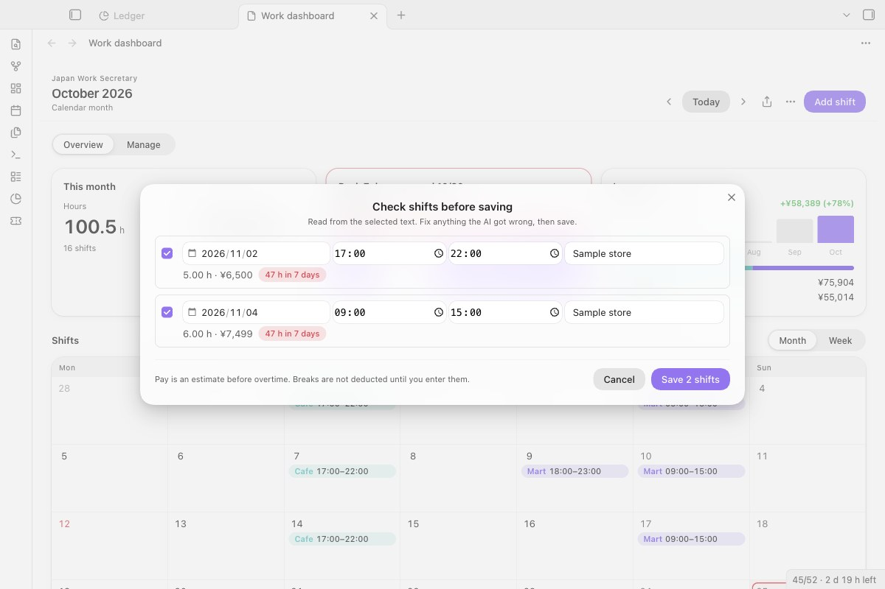
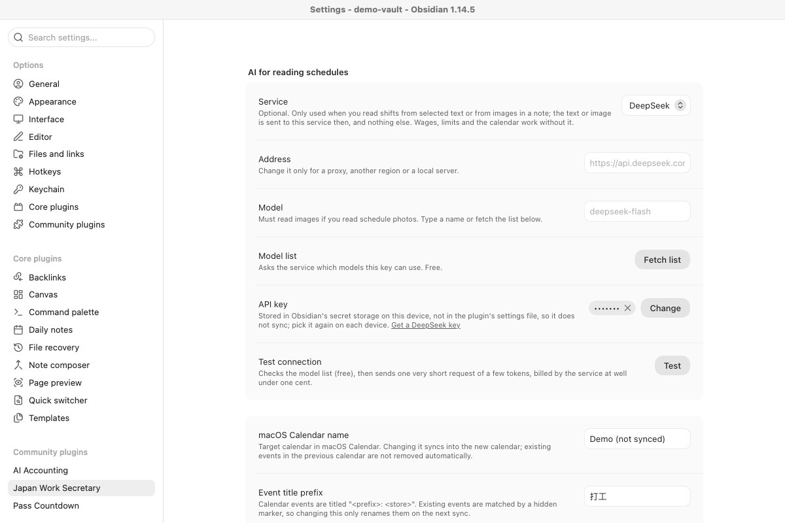

<p align="right"><a href="README.md">English</a> · <a href="README.zh.md">中文</a></p>

<p align="center"><picture><source media="(prefers-color-scheme: dark)" srcset="assets/readme/icon-dark.svg"></picture></p>

<picture>
  <source media="(prefers-color-scheme: dark)" srcset="assets/readme/hero-dark.svg">
  
</picture>

<p align="center"><a href="https://community.obsidian.md/plugins/japan-work-secretary"><b>Obsidian からインストール</b></a></p>



<picture>
  <source media="(prefers-color-scheme: dark)" srcset="assets/readme/cards-dark.svg">
  
</picture>

## 3 ステップで始める

1. 「Settings → Community plugins → Browse」で **Japan Work Secretary** をインストールして有効にし、**Japan Work Secretary: Open dashboard** を実行します。
2. **Settings → Japan Work Secretary** で勤務先と時給を設定します。
3. カレンダーの日付をダブルクリックして、シフトを追加します。

先に試す場合は、空のダッシュボードで **Load a sample week** を押してください。

**動作環境** Obsidian 1.13 以降のデスクトップ版が必要です。カレンダー同期には macOS のカレンダーを使います。**費用** プラグインは無料です。AI によるシフト表の読み取りは任意で、自分の API キーを使います。料金はサービス提供元から請求されます。

うまく動かないときは、[AI アシスタントに貼る確認用プロンプト](docs/troubleshooting.ja.md)をどうぞ。

## その他

<details>
<summary><b>機能一覧</b></summary>

日本でのアルバイトのシフトを記録し、時間帯別の給与と、留学生の週 28 時間の上限を確認できます。



- **給与計算：** 勤務先ごとの早朝・日中・夕方・深夜の時給、残業、祝日手当、実際に取った休憩を反映します。
- **保存前の時間チェック：** シフトを加えると、連続 7 日間で 28 時間を超えるか表示します。学校の長期休業期間は 1 日 8 時間で確認します。
- **保管庫内での管理：** macOS のカレンダーへの同期、.ics の書き出し、メッセージや写真からのシフト読み取りに対応しています。

**シフトの追加**



日付をダブルクリックするとシフトを追加できます。保存前に、給与、休憩の確認状態、そのシフトを含む連続 7 日間の最大勤務時間を表示します。

**シフト・給与・上限**

- **月表示と週表示：** 勤務先ごとに色を分けます。繰り返しのシフトと週のテンプレートも使えます。
- **適用日付きの時給表：** 昇給した日から新しい時給表を追加できます。それ以前のシフトには元の時給を使います。
- **実際に取った休憩：** 各シフトの休憩には「Not confirmed」と「Confirmed」があります。確認前は休憩を差し引かず、予定された勤務時間を 28 時間のチェックに使います。休憩を引いた時間と給与も併記します。比較には入力した予定休憩を使い、未入力なら法定の最低時間を使います。法律上、6 時間を超える労働には 45 分、8 時間を超える労働には 60 分の休憩が必要ですが、実際に休んだことの証明にはなりません（[労働基準法第 34 条](https://laws.e-gov.go.jp/law/322AC0000000049#Mp-Ch_4-At_34)）。
- **深夜は 22:00〜05:00：** 分単位で計算します。21:00〜06:00 のシフトは夕方・深夜・早朝の時給に分かれます（[第 37 条](https://laws.e-gov.go.jp/law/322AC0000000049#Mp-Ch_4-At_37-Pr_4)）。
- **残業など：** 1 日 8 時間または週 40 時間を超える残業、勤務先の日曜・祝日手当、法定休日の割増、交通費に対応します。日曜・祝日手当は各時間の暦日で判定します。法定休日の割増は曜日を指定するまで無効です。給与月の開始日は任意に設定できます。
- **連続 7 日間の 28 時間：** 勤務時間が最も多い期間をカレンダーに表示します。学校の長期休業期間は 1 日 8 時間で確認します。学期中と長期休業が混在する週は「Needs checking」と表示し、全時間を 28 時間の判定に含めます。参照した公式ページには、このような週の数え方が書かれていないためです。
- **収入の通知ライン：** 月単位・年単位で自分で設定します。税額の判定はしません。



**カレンダーと給与ノート**

- **macOS カレンダーへの同期：** ⋯ メニューから実行します。スマート同期は変更のあるシフトだけを書き込みます。予定には識別用のマーカーが付き、同じ予定を更新します。削除したシフトに対応する予定も削除します。
- **.ics の書き出し：** Google カレンダー、Outlook、スマートフォンに取り込めます。
- **Bases の締切表示：** エントリーシート、面接、在留カード更新などのノートを集めた Base で、ビューを「Deadlines」に切り替えます。期限切れ・今日・今週・来週・それ以降に分け、週末と日本の祝日を除いた残りの営業日数を表示します。`submitted` などのチェックボックスプロパティを選ぶと、完了したものを隠せます。Bases が無効な場合、他の機能には影響しません。
- **給与ノートの保存：** 各シフト、勤務先別の合計、残業を Markdown ノートにまとめます。給与明細との照合に使えます。

<picture>
  <source media="(prefers-color-scheme: dark)" srcset="assets/readme/bases-dark.png">
  
</picture>

**初回の手順**

1. **Japan Work Secretary** をインストールして有効にし、**Japan Work Secretary: Open dashboard** を実行します。
2. 空のダッシュボードで **Load a sample week** を押します。「Sample store」の架空のシフトが 5 件入り、勤務時間・給与見込み・28 時間チェックを確認できます。サンプルは同期・エクスポートの対象外です。**Remove samples** で削除できます。
3. **Settings → Japan Work Secretary** で勤務先と時給を設定し、日付をダブルクリックして実際のシフトを追加します。
4. 文章や写真のシフト表を読む場合は、**AI for reading schedules** でサービスを選び、**Test** を押します。

</details>

<details>
<summary><b>AI でシフト表を読む</b></summary>



読み取ったシフトは確認リストに表示されます。日付や時間の修正、行の選択解除ができ、28 時間を超える行も確認できます。Save を押すまで保存されません。

- **進捗・キャンセル・再試行：** 読み取り中は処理の段階を表示します。Cancel を押すと返答を破棄します。失敗時はキーの未設定・拒否、残高不足、モデル名の誤り、応答のタイムアウトなどを表示し、Retry を選べます。キーがない場合や拒否された場合は Open settings を表示します。
- 複数の画像のうち一部だけ読み取れた場合も、成功した分は確認リストに進みます。失敗した画像は通知に表示します。



- **プリセット：** DeepSeek（初期設定）、Qwen、SiliconFlow、Kimi、Zhipu GLM、Google Gemini、OpenAI を選べます。他の OpenAI 互換サービスやローカルサーバーも使えます。写真には画像を読み取れるモデルが必要です。
- **Model list：** キーで使えるモデルをサービスに問い合わせます。無料です。
- **Test：** モデル一覧を確認した後、数トークンの短いリクエストを送ります。モデル一覧の取得は無料で、リクエストの料金はサービス提供元が決めます。

</details>

<details>
<summary><b>必要なもの・データの送信先・アクセス範囲</b></summary>

| 項目 | 内容 |
|---|---|
| Obsidian | 1.13 以降のデスクトップ版です。 |
| カレンダー同期 | macOS のカレンダーを使います。.ics の書き出しは他の OS でも使えます。 |
| プラグイン | 無料、MIT ライセンスです。専用アカウントや独自サーバーはありません。 |
| AI による読み取り | 任意です。自分のキーを使い、送信量に応じてサービス提供元に支払います。シフト表の写真 1 枚で数千トークン使うことがあります。使用量はモデルや画像サイズによって変わります。他の機能は AI なしで動作します。 |

| データ | 送信先 | タイミング |
|---|---|---|
| 選択した文章・開いているノート内の画像 | 選んだ AI サービス | Read shifts from selected text または Read shifts from images in the current note を実行したときだけです。 |
| 「ok と返答」という短いリクエスト | AI サービス | Test を押したときだけです。 |
| シフトの予定 | ローカルの macOS カレンダー（AppleScript） | 同期時です。 |
| 日本の祝日のダウンロード | `holidays-jp.github.io` | 起動後、週単位のキャッシュを更新する時期になったときです。 |
| 円から人民元への為替レートのリクエスト | `frankfurter.dev`。最新レートを取得できない場合は `exchangerate-api.com` | ダッシュボードを開いたとき、ビューごとに 1 時間に 1 回まで取得します。給料日以降は、その日のレートを取得して保存します。 |

- **API キー：** この端末の Obsidian のシークレットストレージに保存します。プラグインの設定にはキー名だけを保存するため、キーは同期されません。別の端末では選び直してください。
- **シフト・勤務先・時給・設定：** 保管庫内のプラグインの `data.json` に保存します。
- **テストの診断情報：** サービス、接続先、モデル、エラーを含みます。キーやシフト内容は含みません。

#### プラグインがアクセスするもの

- **実行するプログラムは `osascript` のみです。** プラグインディレクトリの「Shell Execution」はこの処理を指します。シフトの追加・変更・削除や同期時に、macOS カレンダーの予定を追加・更新・削除します。AppleScript はプラグイン内で固定されており、シフト情報は引数として渡します。コマンド文字列には組み込みません。他のプログラムは起動しません。
- **クリップボードは書き込みのみです。** エクスポート画面の Copy はシフトの文章を、Test の横のコピーボタンは診断情報をコピーします。クリップボードは読みません。
- **ネットワーク通信は 3 種類です。** シフトの読み取り・モデル一覧の取得・Test の実行時に、設定した AI サービスに接続します。祝日は `holidays-jp.github.io`、為替レートは `frankfurter.dev` から取得し、最新レートの取得に失敗した場合は `exchangerate-api.com` を使います。利用状況の送信や独自サーバーはありません。

</details>

<details>
<summary><b>手動インストールと更新</b></summary>

**Obsidian から：** Settings → Community plugins → Browse で **Japan Work Secretary** を検索します。[PKMer](https://pkmer.cn/Pkmer-Docs/00-%E5%85%B3%E4%BA%8E/pkmer%E7%A4%BE%E5%8C%BAfaq/) も公式ディレクトリに登録されたプラグインを自動で同期します。

**手動の場合：** [最新リリース](https://github.com/Rexxall/japan-work-secretary/releases/latest)から `main.js`、`manifest.json`、`styles.css` をダウンロードし、`<vault>/.obsidian/plugins/japan-work-secretary/` に置きます。Obsidian を再読み込みし、プラグインを有効にします。

**ダウンロードの検証：** 1.7.1 以降は GitHub Actions が配布ファイルをビルドし、ビルド元の署名付き証明を付けます。`gh attestation verify main.js --repo Rexxall/japan-work-secretary` で検証できます。

**1.4.x からの更新：** Gemini のキーと設定を引き継ぎます。Gemini は AI for reading schedules 内のサービスの一つになりました。1.4.0 より前に macOS キーチェーンに保存したキーは読み取らなくなりました。AI for reading schedules で選び直すか入力した後、キーチェーンアクセスでサービス名 `obsidian-japan-work-secretary` の項目を削除してください。

</details>

<details>
<summary><b>計算と同期の仕組み</b></summary>

- **28 時間チェック：** 出入国在留管理庁の留学生の資格外活動許可のページには「１週について２８時間以内（教育機関の長期休業期間にあっては、１日について８時間以内）」とあります（[出典](https://www.moj.go.jp/isa/applications/procedures/nyuukokukanri07_00003.html)、元の記録では 2026 年 11 月 2 日に確認）。週の開始日は指定されていないため、プラグインは選んだ日を含む七つの連続 7 日間を調べ、最大値を表示します。有給休暇は含めません。
- **時給表：** 勤務先ごとに `effectiveFrom` の適用日を持ちます。シフト当日までに適用された最新の表を使います。
- **カレンダー同期：** シフトの指紋には予定に表示する情報だけを含めるので、時給を変えてもカレンダーを書き直しません。AppleScript には値を引数で渡すため、勤務先名に引用符があっても扱えます。
- **AI リクエスト：** Obsidian の `requestUrl` を使います。キーはヘッダーに入れ、URL には含めません。

</details>

<details>
<summary><b>制限</b></summary>

- Obsidian の言語が中国語の場合は中国語、それ以外は英語の画面になります。
- 勤務時間や収入のルールは参考情報です。学校の案内と、ダッシュボードの情報ボタンから開ける公式ページを確認してください。
- カレンダー同期は macOS のカレンダーアプリのみ対応しています。

</details>

<details>
<summary><b>開発と変更履歴</b></summary>

```bash
npm install
npm run build
npm test      # 連続 7 日間、長期休業、給与、同期計画、給与ノート、.ics、AI 応答、移行
```

`styles.css` は自動生成されます。`styles/plugin.css` を編集して `npm run styles` を実行します。

**1.9.0：** AI プロバイダーを 12 社内蔵しました。キーは Obsidian のキーチェーンから選び、プラグイン間で共有します。「確認」でそのキーが使えるモデルを一覧表示します。

**1.8.0：** Bases の Deadlines ビューを追加しました。週末と日本の祝日を除いた残りの営業日数を表示します。祝日データは Obsidian の起動後に更新します。

**1.7.0：** 各シフトに休憩の確認状態を追加しました。未確認の間は、休憩を引いた場合と引かない場合の時間・給与を表示します。学期中と長期休業が混在する週には Needs checking と表示します。

**1.6.0：** コミュニティディレクトリの自動審査の指摘に対応しました。moment と外部プログラムの呼び出しに型を付け、スタイルから `!important`、`all`、`:has()` を除きました。外観は同じです。

**1.5.0：** AI サービスのプリセット、モデル一覧、原因を示す接続テストを追加しました。読み取りには進捗・キャンセル・再試行があります。空のダッシュボードでサンプルの週を読み込めます。給与の数字は狭い表示でもカード内に収まります。全履歴は [CHANGELOG.md](CHANGELOG.md) を参照してください。

</details>

不具合は [Issue](https://github.com/Rexxall/japan-work-secretary/issues/new/choose) で報告できます。ビルドと保守は [CONTRIBUTING.md](CONTRIBUTING.md) を参照してください。MIT ライセンスです。
