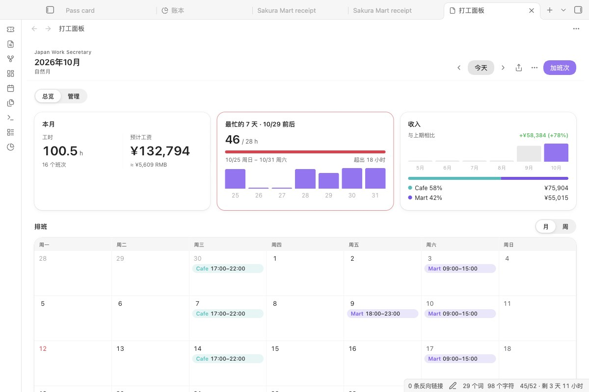

<div align="center">

# Japan Work Secretary

**Shifts, wages and the 28-hour rule for part-time work in Japan, inside Obsidian.**

在 Obsidian 里管理在日本打工的排班、工资和每周 28 小时上限。

[Features](#features) · [Install](#install) · [Privacy](#privacy) · [How it works](#how-it-works) · [中文说明](#中文说明) · [日本語](#日本語)

<picture>
  <source media="(prefers-color-scheme: dark)" srcset="docs/screenshots/dashboard-dark.jpg">
  
</picture>

</div>

## Why

Students in Japan who work part-time juggle three things at once: shift schedules that arrive as photos or chat messages, hourly wages that change by time of day and by store, and a legal cap of 28 hours a week. A spreadsheet can do the arithmetic, but it does not warn you before you book the shift that pushes a 7-day window over the limit.

Japan Work Secretary keeps the schedule in your vault, works out the pay the way a Japanese payslip does, and checks every 7-day window as you add shifts.

## Features

### Schedule

- **Month and week views**, each store in its own colour.
- **Add shifts by hand, or as recurring shifts** (for example every Tuesday 17:00–22:00).
- **Read a schedule from text or a photo.** Select a message, or open a note with a screenshot of the roster. The shifts the AI found open in a check list: fix a date or time, untick a row, and see which rows are already saved or would break the 28-hour or 8-hour rule. Nothing is saved until you press Save (optional, uses your own Gemini API key).

### Pay

- **Time bands:** morning, daytime, evening and late-night rates, per store.
- **Wage changes with a start date.** When your hourly rate goes up, add a new band from that date; earlier shifts keep the old rate.
- **Breaks you actually took.** Enter the break for a shift and it is deducted. If you leave it empty, nothing is deducted: the shift counts as scheduled and is marked *No break entered*. The law says the employer must give 45 minutes over 6 hours and 60 minutes over 8 hours ([MHLW](https://www.mhlw.go.jp/bunya/roudoukijun/faq_kijyunhou_13.html)); that is not proof you had one, so the plugin does not assume it.
- **Overtime** over 8 hours a day or 40 hours a week, holiday bonus, commuting allowance, and a payroll month that can start on any day (for example the 21st).
- **Japanese public holidays** are fetched and cached; you can add your own.

### Limits

- **28 hours in any 7 days.** The dashboard shows the busiest 7-day window around the selected day and how many hours are left.
- **Long school vacations.** Enter the vacation dates from your school; on those days the plugin checks 8 hours per day instead.
- **Income alert lines.** Set your own monthly or yearly amounts and see how close you are. The plugin does not decide tax for you; thresholds change from year to year, so you enter the numbers that apply to you.


### Calendar

- **Sync to macOS Calendar** from the ⋯ menu. Smart sync only writes shifts that changed since the last sync; a full sync rewrites everything in a range. Events carry a hidden marker, so they are updated in place instead of duplicated.
- **Clean up.** When you sync, events whose shifts you have deleted are removed from the calendar.
- **Any other calendar:** *Share or export → Export .ics* saves a calendar file for Google Calendar, Outlook or your phone. Events keep the shift's ID, so importing again updates them.

### Pay notes

*Share or export → Save pay note* writes a Markdown note for the chosen range (by default the payroll month on screen): every shift with its hours and pay, totals by store, and the period total including overtime. Keep it next to your payslip (給与明細) to check it.

### Adding a shift

Double-click a day. Before you save, the dialog shows the pay, whether a break has been entered, and what the shift does to the busiest 7 days.


## Install

**From Obsidian (once listed):** Settings → Community plugins → Browse, search for **Japan Work Secretary**.

**Manually:**

1. Download `main.js`, `manifest.json` and `styles.css` from the latest release.
2. Put them in `<your vault>/.obsidian/plugins/japan-work-secretary/`.
3. In Obsidian: **Settings → Community plugins → reload**, then enable **Japan Work Secretary**.
4. Open the dashboard from the command palette: **Japan Work Secretary: Open dashboard**.

Desktop only, Obsidian 1.13 or later. Calendar sync needs macOS; the .ics export works everywhere.

### First-time setup

1. **Settings → Wage rates:** rename *Store A*, set its hourly rates, add more stores if you have them.
2. **Settings → Compliance & cycle:** add your school's long vacation dates and any income alert lines you want.
3. Optional: under **Gemini API key**, choose or create a secret to read schedules from text or photos.

## Privacy

| What | Where it lives |
|---|---|
| Shifts, stores, wages, settings | `data.json` in this plugin's folder in your vault |
| Gemini API key | Obsidian's secret storage on this device; the plugin's settings keep only the secret's name |
| Text or image you choose to parse | Sent to Google Gemini, only when you run a parse command |
| Calendar events | Your local macOS Calendar, through AppleScript; or an .ics file in your vault when you export one |
| Pay notes | Markdown notes in the export folder you choose |
| Public holidays | Downloaded from `holidays-jp.github.io` |
| JPY → CNY rate (shown next to wages) | Downloaded from `exchangerate-api.com`, `frankfurter.dev` as a fallback |

There is no account and no server of our own.

## How it works

- **28-hour check:** the Immigration Services Agency's page on work permission for students says "１週について２８時間以内（教育機関の長期休業期間にあっては、１日について８時間以内）" ([source](https://www.moj.go.jp/isa/applications/procedures/nyuukokukanri07_00003.html), checked 29 October 2026). The page does not say which day a week starts on, so the plugin takes the cautious reading: for the selected day it looks at all seven 7-day windows that include it and reports the largest total. Paid leave is not counted. A 7-day window made only of long-vacation days is checked against 8 hours a day instead. A window that mixes term days and vacation days is held to 28 hours with all of its hours and marked, because the official page does not say how such a week is counted; this is the stricter reading. Long vacations are the periods in your school's calendar, not days you simply have no class.
- **Wage bands:** each store keeps a list of rate tables with an `effectiveFrom` date. A shift uses the newest table that started on or before its date.
- **Calendar sync:** every shift gets a fingerprint made only of the fields that appear in the event (date, times, store, calendar, title). Changing a wage does not rewrite your calendar; changing a time does. AppleScript receives values as arguments rather than as text pasted into the script, so store names with quotes or non-Latin characters are safe.
- **API key:** kept in Obsidian's secret storage (Settings → Gemini API key). Several plugins can share one secret, so you paste a Gemini key once. Versions before 1.4.0 kept the key in the macOS Keychain or in plugin data; 1.4.0 copies it into secret storage on first start, under the name `gemini-api-key`, and clears it from plugin data. The Keychain entry is left for other vaults; delete it in Keychain Access (service `obsidian-japan-work-secretary`) once every vault is upgraded.
- **Gemini requests** go through Obsidian's `requestUrl`, with the key in a request header rather than in the URL.

Build from source:

```bash
npm install
npm run build     # writes main.js
npm test          # 27 tests: 28-hour windows, vacations, wages, calendar sync planning, pay notes, .ics, reading AI replies
```

`styles.css` is generated. Edit `styles/plugin.css` (or the shared glass kit `styles/apple-kit.css` and `styles/ap-helpers.css`, the same in all of my plugins) and run `npm run styles`.

## Known limits

- Rules about hours and income are for reference only. Check your school and the official pages linked in the dashboard (ⓘ).
- Calendar sync works with the macOS Calendar app only.

## Changelog

**1.4.0**

- New look in the style of current Apple apps: solid cards and grouped lists, a glass header bar and glass dialogs, settings drawn as grouped lists. Follows your theme and accent colour; glass turns solid when the system asks for reduced transparency. The paper style option is gone.
- Breaks are no longer deducted automatically. A shift without an entered break counts as scheduled and is marked *No break entered*; the add-shift dialog has a break field.
- A 7-day window that mixes term days and the long vacation is now held to 28 hours with all its hours (previously vacation days were left out), and is marked with a link to the official page.
- Shifts read by the AI open in a check list before anything is saved: edit or untick rows, see duplicates and rows that would break the 28-hour or 8-hour rule.
- *Save pay note*: a Markdown note with every shift, totals by store and overtime, to check against your payslip.
- *Export .ics* for Google Calendar, Outlook and phones.
- The Gemini key moves to Obsidian's secret storage and can be shared with other plugins.
- Requires Obsidian 1.13: settings use Obsidian's own pages and lists (stores, wage bands and income alerts can be added and removed there) and show up in settings search.
- Late-night hours are named as what they are, 22:00–05:00, and the store's Sunday and holiday bonus goes by the calendar day of each hour, so a Saturday night shift gets it only after midnight.
- The statutory rest day (法定休日) premium is a separate setting, off until you name the day; the legal minimum rate is 1.35.
- Income alerts switched on in 1.1.x stay on after the upgrade (they were reset before). Stored hours and pay are recalculated with the current rules on start.
- Gemini is called through Obsidian's `requestUrl` instead of Google's SDK; the plugin file is about 170 KB instead of 960 KB. Images are read from the vault instead of the file system.
- The AI prompt no longer assumes a particular store or the year 2026.
- Deleting a recurring shift or a template takes a second click instead of a browser dialog. Settings and commands use sentence case and Obsidian's own section headings.

**1.3.0**

- Dashboard redesigned: four numbers at the top (hours, estimated wage, busiest 7 days, income), and the busiest 7 days are marked on the calendar. Shift chips show the store and the time.
- The 7-day card shows the hours of each day in that window.
- Adding a shift shows what it does to the busiest 7 days before you save; above 28 hours the button reads "Save anyway".
- Settings show the default wage bands as one strip across the day.
- Chinese interface when Obsidian is set to Chinese; English otherwise. Dates follow the same language.
- A quieter dashboard: only Overview and Manage at the top, month or week beside the calendar, hours and pay in one card, shifts as thin capsules. Counting by calendar or work month and the three calendar sync modes moved to the ⋯ menu.
- Styles rewritten from scratch on a small shared style kit; the dashboard no longer uses inline styles.

**1.2.0**

- Long vacation periods with the 8-hour daily check.
- Income alert lines you set yourself, replacing the fixed 8.8万 / 103万 / 130万 toggles (old settings are migrated).
- Configurable calendar event title.
- Policy notes rewritten to stable rules with links to the official pages.
- Breaks can no longer exceed the shift length.
- Store colours cycle through five colours, so any number of stores works; the default store is now a neutral example.

**1.1.0** — Smart, range and full calendar sync with change detection.

## License

MIT

---

## 中文说明

在日本打工的留学生，常常同时要管三件事：排班表（照片或聊天消息）、按时段和店铺变化的时薪，以及每周 28 小时的上限。这个插件把排班放进 Obsidian，按日本工资条的算法算工资，并在你加班次时检查每一个连续 7 天。

- **排班：** 月视图、周视图；固定班次；可从选中的文字或排班截图里识别班次，先进核对清单（可改日期时间、取消某行，标出已存在和会超 28 小时／8 小时的行），点保存才入库（可选，用你自己的 Gemini 密钥）。
- **工资：** 早、日、晚、深夜分时段时薪，按店铺设置；时薪上调可按生效日期新增；休息按实际填写扣除，没填就按排班原样计并标“未填休息”（法定 6 小时以上 45 分钟、8 小时以上 60 分钟是雇主应给的休息，不代表一定休了）；加班、节假日加给、交通费、从任意一天开始的工资月。
- **上限：** 任意连续 7 天 28 小时；学校长假期间改为每天 8 小时（在设置里填长假日期）；一周里学期和长假混在一起时，从严按全部工时计 28 小时并提示；收入提醒线由你按当年规定自己填写，插件不替你判断税额。
- **日历：** 同步到 macOS 日历，只写有变化的班次，用隐藏标记原地更新、不重复；也可导出 .ics 给 Google 日历、Outlook、手机。
- **中文界面（1.4.0）：** Obsidian 设为中文时整个界面显示中文，否则显示英文；按自然月或工资月统计、三种日历同步都放在面板右上角的 ⋯ 菜单里。
- **工资笔记（1.4.0）：** 按所选区间生成 Markdown 笔记，列出每个班次、按店合计和含加班的总额，方便对照工资条。
- **密钥（1.4.0）：** 存在 Obsidian 的密钥库里，可与其他插件共用；旧版存的密钥首次启动自动迁移。需 Obsidian 1.13 以上。
- **工资规则（1.4.0）：** 深夜时段明确为 22:00–05:00；店铺周日和节假日津贴按每小时所在的日期计算，周六夜班过了零点才算周日；法定休日割增单独设置，默认关闭，法定最低 1.35 倍。
- **隐私：** 数据都在你的库里；只有在你执行识别命令时，选中的文字或图片才会发给 Gemini。

## 日本語

日本でアルバイトをする留学生向けに、シフト・給与・週28時間の上限を Obsidian の中で管理するプラグインです。

- **シフト：** 月表示・週表示、固定シフト。シフト表の文章やスクリーンショットから読み取り、確認リストで修正してから保存します（任意、ご自身の Gemini API キーを使用）。
- **給与：** 朝・日中・夕方・深夜の時給を店舗ごとに設定。時給改定は適用開始日つきで追加。休憩は実際に取った分だけ入力して控除（未入力なら控除せず「休憩未入力」と表示）。残業、祝日手当、交通費、締め日にも対応。
- **上限：** 任意の連続7日間で28時間。学校の長期休業期間は1日8時間で確認（期間は設定に入力）。学期と長期休業がまたがる週は、厳しい方で全時間を28時間に数えて表示します。収入の目安額はご自身で設定します。税額の判断はしません。
- **カレンダー：** macOS カレンダーへ同期。変更のあったシフトだけを書き込み、重複を作りません。Google カレンダーや Outlook 向けに .ics も書き出せます。
- **給与メモ（1.4.0）：** 期間内のシフト、店舗別の合計、残業を含む総額を Markdown ノートに保存し、給与明細と照合できます。
- **プライバシー：** データは保管庫の中に保存されます。読み取りを実行したときだけ、選んだ文章や画像が Gemini に送られます。
