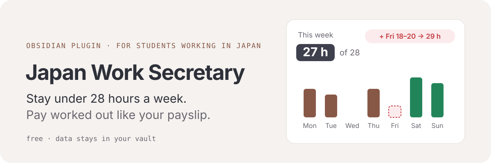
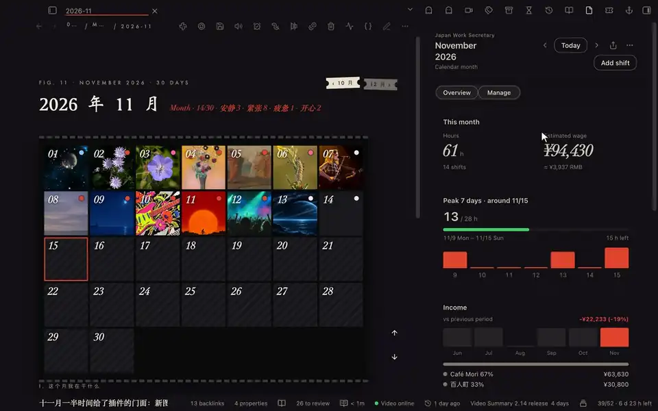
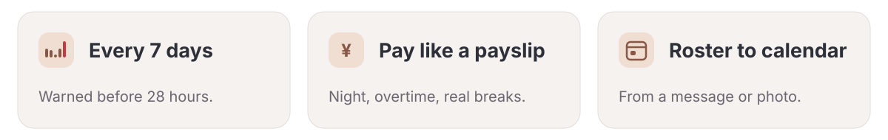
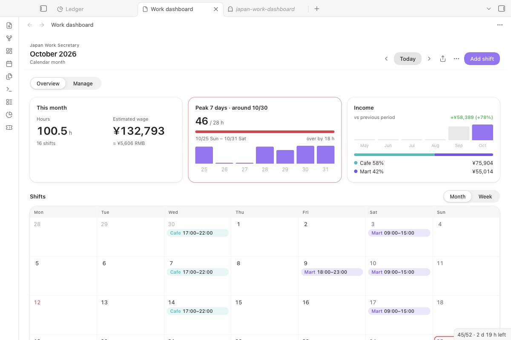
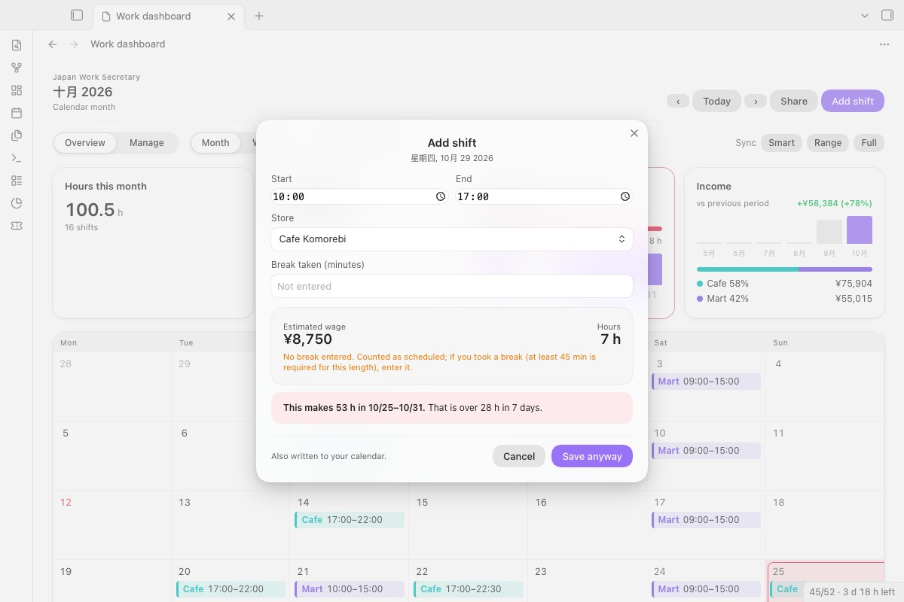
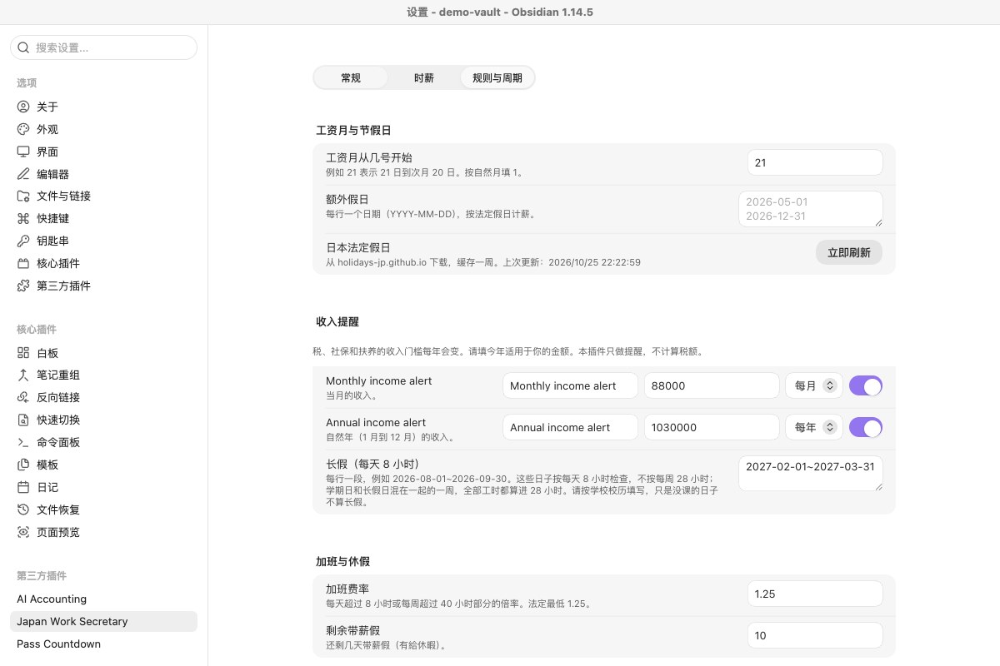
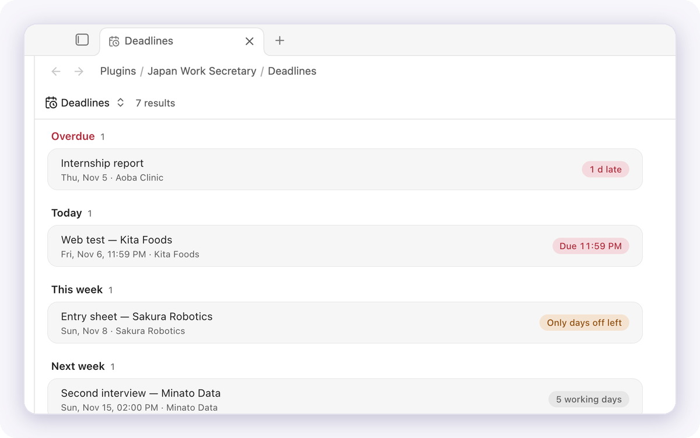
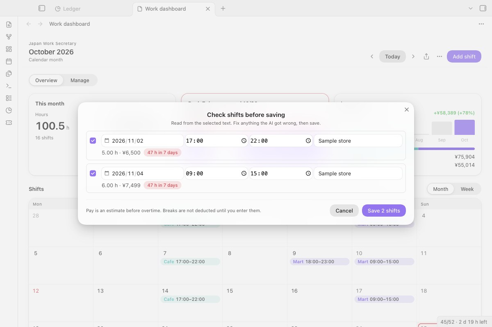
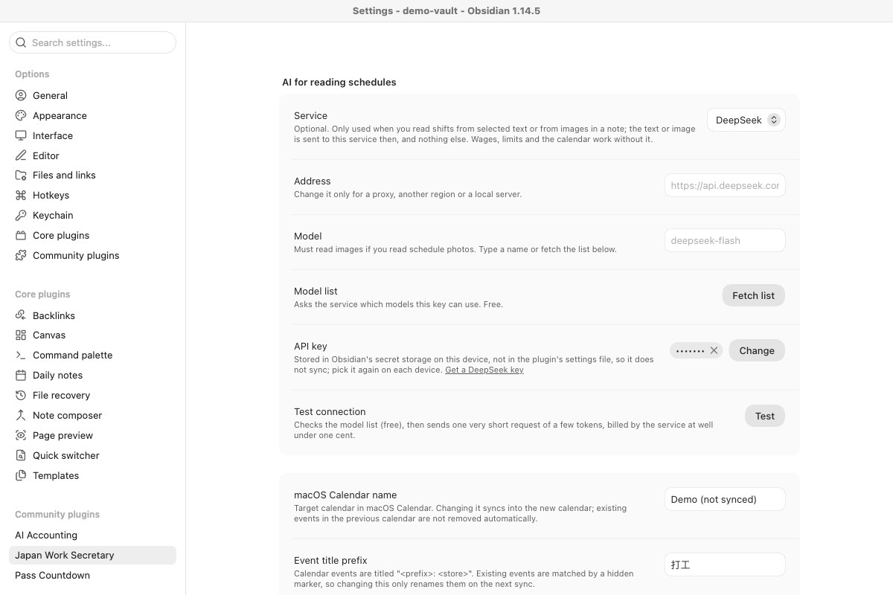

<p align="right"><a href="README.zh.md">中文</a> · <a href="README.ja.md">日本語</a></p>

<p align="center"><picture><source media="(prefers-color-scheme: dark)" srcset="assets/readme/icon-dark.svg"></picture></p>

<picture>
  <source media="(prefers-color-scheme: dark)" srcset="assets/readme/hero-dark.svg">
  
</picture>

<p align="center"><a href="https://community.obsidian.md/plugins/japan-work-secretary"><b>Install from Obsidian</b></a></p>



<picture>
  <source media="(prefers-color-scheme: dark)" srcset="assets/readme/cards-dark.svg">
  
</picture>

## Start in three steps

1. Install **Japan Work Secretary** from *Settings → Community plugins → Browse*, enable it and run **Japan Work Secretary: Open dashboard** to open the dashboard.
2. Open **Settings → Japan Work Secretary** and set your stores and their hourly rates.
3. Double-click a day to add a shift.

Want to look first? Click **Load a sample week** on the empty dashboard.

**Needs** Obsidian <!-- DOCS-SYNC:START min -->1.13<!-- DOCS-SYNC:END --> or later on desktop; Calendar sync uses macOS Calendar. **Costs** The plugin is free. AI roster reading is optional, uses your own key and is billed by your provider.

Something not working? [Copy a fix-it prompt](docs/troubleshooting.md) for your AI assistant.

## Everything else

<details>
<summary><b>Every feature</b></summary>

**Track part-time shifts in Japan: see your pay by time band and get warned before a week goes over the 28-hour student limit.**



- **Works out your pay the way a Japanese payslip does:** morning, day, evening and late-night rates per store, overtime, holiday bonus and breaks you actually took.
- **Checks every 7-day window as you add shifts,** and tells you before you save if a shift pushes a week over 28 hours (8 hours a day during your school's long vacation).
- **Keeps the schedule in your vault,** syncs it to macOS Calendar or exports .ics, and can read a roster from a message or a photo.

**Adding a shift**



Double-click a day to add a shift. Before saving, the dialog shows pay, break confirmation and the busiest 7-day total including this shift.

**Schedule, pay and limits**

- **Month and week views,** one colour per store; recurring shifts and weekly templates.
- **Wage bands with start dates:** when your rate goes up, add a band from that date; earlier shifts keep the old rate.
- **Breaks you actually took.** Each shift's break is *Not confirmed* or *Confirmed*. Until you confirm it, nothing is deducted: the shift counts as scheduled toward the 28 hours, and the hours and pay with the break deducted are shown beside it (your planned break, or the legal minimum). The law says the employer must give a 45-minute break for work over 6 hours and a 60-minute break for work over 8 hours ([Labour Standards Act art. 34](https://laws.e-gov.go.jp/law/322AC0000000049#Mp-Ch_4-At_34)); that is not proof you had one.
- **Late night is 22:00–05:00** ([art. 37](https://laws.e-gov.go.jp/law/322AC0000000049#Mp-Ch_4-At_37-Pr_4)), counted minute by minute, so a 21:00–06:00 shift splits into evening, late-night and morning rates.
- **Overtime** over 8 hours a day or 40 a week, the store's Sunday and holiday bonus by calendar day, the statutory rest day premium (off until you name the day), commuting allowance, and a payroll month starting on any day.
- **28 hours in any 7 days,** with the busiest window marked on the calendar. **Long vacations** from your school's calendar are checked at 8 hours a day; a week mixing term and vacation days is marked *Needs checking* and held to 28 hours with all its hours, because the official page does not say how such a week is counted.
- **Income alert lines** you set yourself, monthly or yearly. The plugin does not decide tax.



**Calendar and pay notes**

- **Sync to macOS Calendar** from the ⋯ menu: smart sync writes only changed shifts, events carry a hidden marker and are updated in place, and events for deleted shifts are removed.
- **Export .ics** for Google Calendar, Outlook or a phone.
- **Deadline view for Bases.** In a base of application notes (entry sheets, interviews, a residence card renewal), switch the view to *Deadlines*: overdue, today, this week, next week and later, each with the working days left, skipping weekends and Japanese public holidays. Pick a checkbox property such as `submitted` to hide what is done. With Bases turned off nothing changes.
- **Save pay note:** a Markdown note with every shift, totals by store and overtime, to check against your payslip (給与明細).

<picture>
  <source media="(prefers-color-scheme: dark)" srcset="assets/readme/bases-dark.png">
  
</picture>

**Start here, step by step**

1. Install and enable **Japan Work Secretary** and run **Japan Work Secretary: Open dashboard** to open the dashboard.
2. On an empty dashboard, click **Load a sample week** to add five made-up shifts at *Sample store*. They show hours, estimated pay and the 28-hour check. They are never synced or exported, and **Remove samples** deletes them.
3. Open **Settings → Japan Work Secretary** and set your stores and their hourly rates, then double-click a day to add a real shift.
4. Optional: to read rosters from text or photos, choose an AI service under **AI for reading schedules** and click **Test** to check the connection.

</details>

<details>
<summary><b>Reading a roster with AI</b></summary>



*Shifts the AI found open in a check list. Fix a date or time, untick a row, see which rows would break the 28-hour rule. Nothing is saved until you press Save.*

- **Progress, Cancel and Retry.** While a roster is read, a notice shows the step; *Cancel* drops the reply. On failure it says why (no key, key rejected, out of balance, model not found, no reply in time) and offers *Retry*, or *Open settings* when the key is missing or rejected.
- With several images, the ones that worked still reach the check list; the notice names the ones that did not.



- **Presets:** DeepSeek (default), Qwen, SiliconFlow, Kimi, Zhipu GLM, Google Gemini, OpenAI, or any OpenAI-compatible or local server. For roster photos, pick a model that reads images.
- **Model list** asks the service which models your key can use (free).
- **Test connection** checks the model list (free), then sends one very short request of a few tokens. The provider sets the price.

</details>

<details>
<summary><b>What it needs, where your data goes, what the plugin touches</b></summary>

| | |
|---|---|
| Obsidian | 1.13 or later, desktop only |
| Calendar sync | macOS Calendar. The .ics export works anywhere. |
| The plugin | Free, MIT licence. No account, no server of ours. |
| AI for rosters | Optional. Your own key; you pay your AI provider for what you send. A roster photo can use a few thousand tokens; usage depends on the model and image size. Everything else works without it. |

| What | Sent to | When |
|---|---|---|
| The selected text or the images in the open note | The AI service you chose | Only when you run *Read shifts from selected text* or *Read shifts from images in the current note* |
| A tiny "reply with ok" request | The AI service | Only when you click **Test** |
| Shift events | Your local macOS Calendar (AppleScript) | When you sync |
| Public holiday download | `holidays-jp.github.io` | After startup when the weekly cache is due for refresh |
| Yen-to-yuan rate request | `frankfurter.dev`, with `exchangerate-api.com` as fallback for the live rate | On dashboard open, limited to once an hour per view; once payday arrives, the rate for that day is fetched and cached |

- **The API key** lives in Obsidian's secret storage on this device. The plugin's settings keep only its name, so the key does not sync: on a new device, choose it again.
- **Shifts, stores, wages and settings** stay in the plugin's `data.json` in your vault.
- **Diagnostics** from the test contain the service, address, model and error, but no key and no shift content.

#### What the plugin touches

- **One program: `osascript`** (the directory's "Shell Execution" note), only to add, update and remove your shift events in macOS Calendar when you add, edit or delete shifts and when you sync. The AppleScript is fixed in the plugin; shift details are passed to it as arguments, never built into a command. No other program is started.
- **Clipboard: write only.** **Copy** in the export window copies the schedule text; the copy button next to **Test** copies the diagnostics. It never reads the clipboard.
- **Network: three kinds of request, nothing else.** The AI service at the address in your settings, only when you read a roster, fetch the model list or click **Test** in settings; `holidays-jp.github.io` for public holidays; `frankfurter.dev`, or `exchangerate-api.com` if that fails, for the exchange rate. No analytics, no server of ours.

</details>

<details>
<summary><b>Install by hand, and upgrading</b></summary>

**From Obsidian:** Settings → Community plugins → Browse, search for **Japan Work Secretary** and enable it. [PKMer](https://pkmer.cn/Pkmer-Docs/00-%E5%85%B3%E4%BA%8E/pkmer%E7%A4%BE%E5%8C%BAfaq/) also automatically syncs plugins listed in the official directory.

**Manually:** download `main.js`, `manifest.json` and `styles.css` from the [latest release](https://github.com/Rexxall/japan-work-secretary/releases/latest) into `<vault>/.obsidian/plugins/japan-work-secretary/`, reload Obsidian and enable the plugin.

**Checking a download:** from 1.7.1 on, GitHub Actions builds the release files and signs where they came from. Check one with `gh attestation verify main.js --repo Rexxall/japan-work-secretary`.

**From 1.4.x:** your Gemini key and settings carry over; Gemini is now one of the services under *AI for reading schedules*. A key kept in the macOS Keychain by versions before 1.4.0 is no longer read: choose or enter it again under *AI for reading schedules*, then delete the Keychain entry (service `obsidian-japan-work-secretary`).

</details>

<details>
<summary><b>How it works</b></summary>

- **28-hour check:** the Immigration Services Agency's page on work permission for students says "１週について２８時間以内（教育機関の長期休業期間にあっては、１日について８時間以内）" ([source](https://www.moj.go.jp/isa/applications/procedures/nyuukokukanri07_00003.html), checked 2 November 2026). It does not say which day a week starts, so for the selected day the plugin looks at all seven 7-day windows that include it and reports the largest. Paid leave is not counted.
- **Wage bands:** each store keeps rate tables with an `effectiveFrom` date; a shift uses the newest one that started on or before its date.
- **Calendar sync:** a shift's fingerprint covers only what appears in the event, so changing a wage does not rewrite your calendar. AppleScript receives values as arguments, so store names with quotes are safe.
- **AI requests** go through Obsidian's `requestUrl`, with the key in a header, never in the URL.

</details>

<details>
<summary><b>Limits</b></summary>

- The interface uses Chinese when Obsidian is set to Chinese, and English otherwise.
- Rules about hours and income are for reference only. Check your school and the official pages linked in the dashboard (ⓘ).
- Calendar sync works with the macOS Calendar app only.

</details>

<details>
<summary><b>Development and changelog</b></summary>

```bash
npm install
npm run build
npm test      # 28-hour windows, vacations, wages, calendar sync planning, pay notes, .ics, AI replies, migration
```

`styles.css` is generated: edit `styles/plugin.css` and run `npm run styles`.

**1.9.0:** twelve AI providers built in, with the key picked from Obsidian's Keychain and shared by every plugin; **Check** lists the models the key can use.

**1.8.0:** a *Deadlines* view for Bases with working days left, skipping weekends and Japanese holidays; the holiday list is refreshed after Obsidian has started.

**1.7.0:** every shift has a break status; until it is confirmed, hours and pay are shown both with and without the break, and mixed vacation weeks are marked *Needs checking*.

**1.6.0:** no findings left in the community directory's review: typed moment and shell calls, no `!important`, `all` or `:has()` in the styles, the same look.

**1.5.0:** AI for reading rosters with Chinese and other service presets, a model list and a test that names the problem; progress with Cancel and Retry; a sample week for an empty dashboard; pay figures stay inside their card at any width. Full history in [CHANGELOG.md](CHANGELOG.md).

</details>

Issues: [Open an issue](https://github.com/Rexxall/japan-work-secretary/issues/new/choose). Build and maintenance: [CONTRIBUTING.md](CONTRIBUTING.md). MIT licence.
