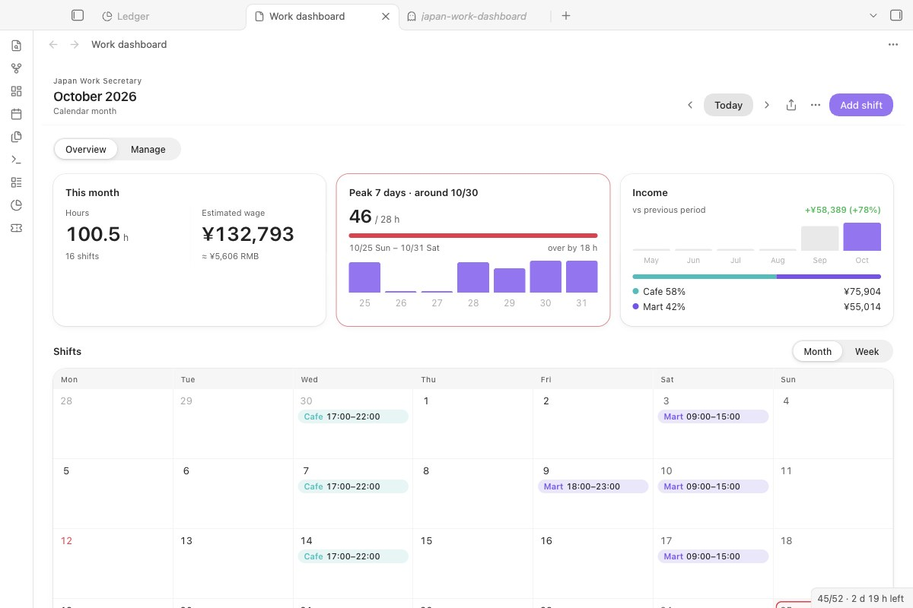

<div align="center">

# Japan Work Secretary

**Track part-time shifts in Japan: see your pay by time band and get warned before a week goes over the 28-hour student limit.**

[中文说明 →](README.zh.md) · [日本語](#日本語)



</div>

## What it does

- **Works out your pay the way a Japanese payslip does:** morning, day, evening and late-night rates per store, overtime, holiday bonus and breaks you actually took.
- **Checks every 7-day window as you add shifts,** and tells you before you save if a shift pushes a week over 28 hours (8 hours a day during your school's long vacation).
- **Keeps the schedule in your vault,** syncs it to macOS Calendar or exports .ics, and can read a roster from a message or a photo.

## Start here

1. Install and enable **Japan Work Secretary**, then run **Japan Work Secretary: Open dashboard**.
2. On an empty dashboard, click **Load a sample week**. Five made-up shifts at *Sample store* show hours, estimated pay and the 28-hour check. They are never synced or exported, and **Remove samples** deletes them.
3. In **Settings → Japan Work Secretary**, set your stores and their hourly rates, then double-click a day to add a real shift.
4. Optional: to read rosters from text or photos, choose an AI service under **AI for reading schedules** and click **Test**.

## What it needs and what it costs

| | |
|---|---|
| Obsidian | 1.13 or later, desktop only |
| Calendar sync | macOS Calendar. The .ics export works anywhere. |
| The plugin | Free, MIT licence. No account, no server of ours. |
| AI for rosters | Optional. Your own key; you pay your AI provider for what you send. One roster photo is a few thousand tokens. Everything else works without it. |

## Where your data goes

| What | Sent to | When |
|---|---|---|
| The selected text or the images in the open note | The AI service you chose | Only when you run *Read shifts from selected text* or *Read shifts from images in the current note* |
| A tiny "reply with ok" request | The AI service | Only when you click **Test** |
| Shift events | Your local macOS Calendar (AppleScript) | When you sync |
| Nothing (downloads only) | `holidays-jp.github.io` for public holidays; `exchangerate-api.com` or `frankfurter.dev` for the yen-to-yuan rate shown next to pay | About once a week |

- **The API key** lives in Obsidian's secret storage on this device. The plugin's settings keep only its name, so the key does not sync: on a new device, choose it again.
- **Shifts, stores, wages and settings** stay in the plugin's `data.json` in your vault.
- **Diagnostics** from the test contain the service, address, model and error, but no key and no shift content.

## Reading a roster


*Shifts the AI found open in a check list. Fix a date or time, untick a row, see which rows would break the 28-hour rule. Nothing is saved until you press Save.*

- **Progress, Cancel and Retry.** While a roster is read, a notice shows the step; *Cancel* drops the reply. On failure it says why (no key, key rejected, out of balance, model not found, no reply in time) and offers *Retry*, or *Open settings* when the key is missing or rejected.
- With several images, the ones that worked still reach the check list; the notice names the ones that did not.

## Schedule, pay and limits

- **Month and week views,** one colour per store; recurring shifts and weekly templates.
- **Wage bands with start dates:** when your rate goes up, add a band from that date; earlier shifts keep the old rate.
- **Breaks you actually took.** Leave the break empty and nothing is deducted: the shift counts as scheduled and is marked *No break entered*. The law says the employer must give 45 minutes over 6 hours and 60 minutes over 8 hours ([MHLW](https://www.mhlw.go.jp/bunya/roudoukijun/faq_kijyunhou_13.html)); that is not proof you had one.
- **Overtime** over 8 hours a day or 40 a week, the store's Sunday and holiday bonus by calendar day, the statutory rest day premium (off until you name the day), commuting allowance, and a payroll month starting on any day.
- **28 hours in any 7 days,** with the busiest window marked on the calendar. **Long vacations** from your school's calendar are checked at 8 hours a day; a week mixing term and vacation days is held to 28 hours with all its hours.
- **Income alert lines** you set yourself, monthly or yearly. The plugin does not decide tax.

## Calendar and pay notes

- **Sync to macOS Calendar** from the ⋯ menu: smart sync writes only changed shifts, events carry a hidden marker and are updated in place, and events for deleted shifts are removed.
- **Export .ics** for Google Calendar, Outlook or a phone.
- **Save pay note:** a Markdown note with every shift, totals by store and overtime, to check against your payslip (給与明細).

## AI for reading schedules


- **Presets:** DeepSeek (default), Qwen, SiliconFlow, Kimi, Zhipu GLM, Google Gemini, OpenAI, or any OpenAI-compatible or local server. For roster photos, pick a model that reads images.
- **Model list** asks the service which models your key can use (free).
- **Test connection** checks the model list (free), then sends one very short request (a few tokens, well under one cent).

## Install

**From Obsidian (once listed):** Settings → Community plugins → Browse, search for **Japan Work Secretary**.

**Manually:** download `main.js`, `manifest.json` and `styles.css` from the latest release into `<vault>/.obsidian/plugins/japan-work-secretary/`, reload Obsidian and enable the plugin.

**From 1.4.x:** your Gemini key and settings carry over; Gemini is now one of the services under *AI for reading schedules*. Versions before 1.4.0 kept the key in the macOS Keychain; it is copied into secret storage on first start. Delete the Keychain entry (service `obsidian-japan-work-secretary`) once every vault is upgraded.

## How it works

- **28-hour check:** the Immigration Services Agency's page on work permission for students says "１週について２８時間以内（教育機関の長期休業期間にあっては、１日について８時間以内）" ([source](https://www.moj.go.jp/isa/applications/procedures/nyuukokukanri07_00003.html), checked 29 October 2026). It does not say which day a week starts, so for the selected day the plugin looks at all seven 7-day windows that include it and reports the largest. Paid leave is not counted.
- **Wage bands:** each store keeps rate tables with an `effectiveFrom` date; a shift uses the newest one that started on or before its date.
- **Calendar sync:** a shift's fingerprint covers only what appears in the event, so changing a wage does not rewrite your calendar. AppleScript receives values as arguments, so store names with quotes are safe.
- **AI requests** go through Obsidian's `requestUrl`, with the key in a header, never in the URL.

```bash
npm install
npm run build
npm test      # 28-hour windows, vacations, wages, calendar sync planning, pay notes, .ics, AI replies, migration
```

`styles.css` is generated: edit `styles/plugin.css` and run `npm run styles`.

## Known limits

- Rules about hours and income are for reference only. Check your school and the official pages linked in the dashboard (ⓘ).
- Calendar sync works with the macOS Calendar app only.

## Changelog

**1.5.0:** AI for reading rosters with Chinese and other service presets, a model list and a test that names the problem; progress with Cancel and Retry; a sample week for an empty dashboard; pay figures stay inside their card at any width. Full history in [CHANGELOG.md](CHANGELOG.md).

## License

MIT

---

## 日本語

日本でアルバイトをする留学生向けに、シフト・給与・週28時間の上限を Obsidian の中で管理します。時間帯別の時給、残業、祝日手当、実際に取った休憩で給与を計算し、シフトを追加する前に連続7日間で28時間（長期休業中は1日8時間）を超えないか確認します。macOS カレンダーへの同期と .ics の書き出しに対応。シフト表の文章や写真の読み取りは任意で、DeepSeek、通義、SiliconFlow、Kimi、智譜、Gemini、OpenAI、ローカルサーバーから選べます。API キーはこの端末の Obsidian シークレット保存にあり、同期されません。読み取りを実行したときだけ、選んだ文章や画像が AI サービスに送られます。
