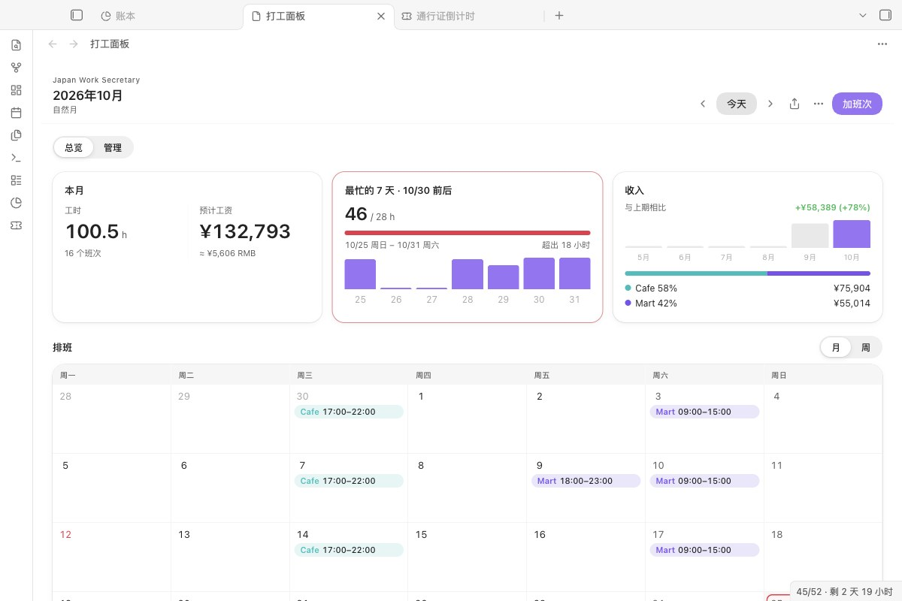
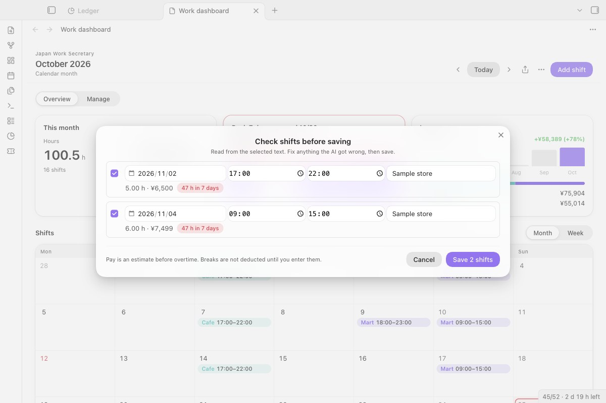
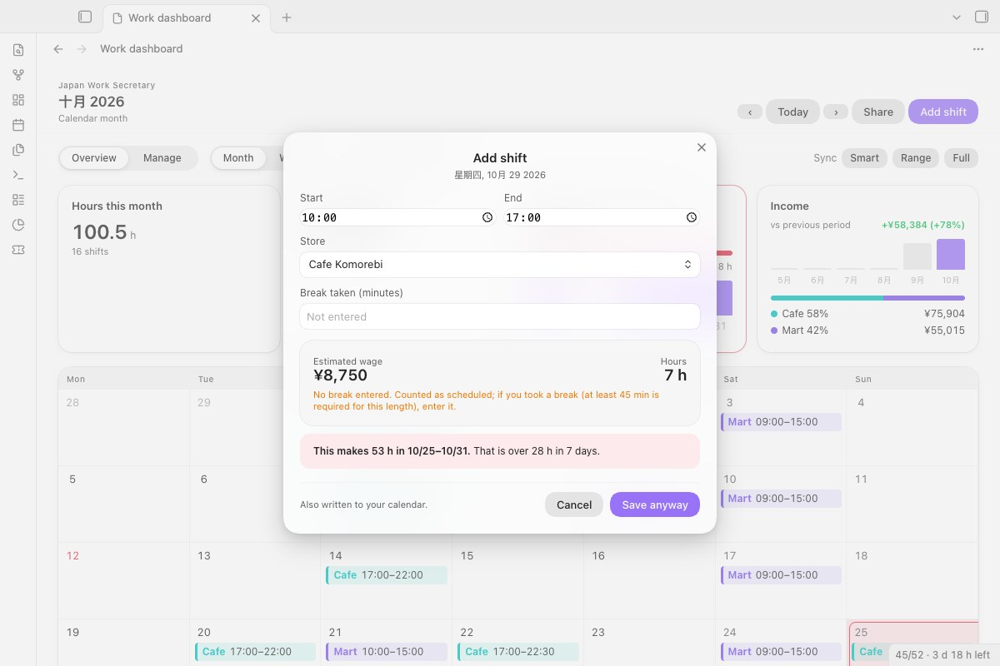
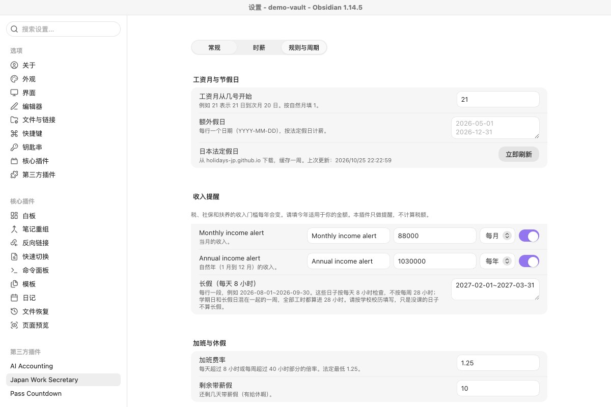
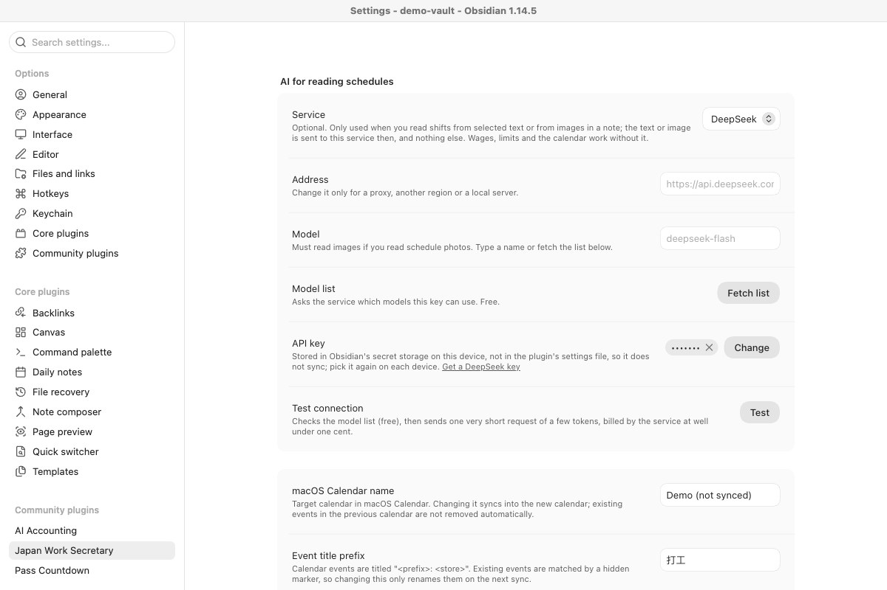

# Japan Work Secretary（日本打工秘书）

**记录在日本的打工排班：按时段算出工资，在一周快超过留学生 28 小时上限之前提醒你。**

[English →](README.md)

## 能做什么

- **按日本工资条的算法算工资：** 各店的早、日、晚、深夜时薪，加班、节假日津贴，以及你实际休息了多少。
- **加班次时检查每一个连续 7 天，** 保存前就告诉你这一班会不会让某一周超过 28 小时（学校长假期间为每天 8 小时）。
- **排班放在你的库里，** 可同步到 macOS 日历或导出 .ics，也能从消息或照片里读出排班。

## 从这里开始

1. 安装并启用 **Japan Work Secretary**，运行命令 **Japan Work Secretary: 打开面板**。
2. 面板是空的时候，点 **载入示例一周**。会出现五个“示例店”的虚构班次，能看到工时、预计工资和 28 小时检查。示例不会同步到日历，也不会导出；点 **删除示例** 一键删掉。
3. 在 **设置 → Japan Work Secretary** 里填好店铺和时薪，然后双击某一天加上真实的班次。
4. 可选：想从文字或照片读排班，在 **AI 读班表** 里选一个 AI 服务，点 **测试**。

## 需要什么、花多少钱

| | |
|---|---|
| Obsidian | 1.13 或更高，只支持电脑 |
| 日历同步 | macOS 日历。导出 .ics 哪里都能用。 |
| 插件本身 | 免费，MIT 许可。不用注册，没有我们自己的服务器。 |
| AI 读班表 | 可不用。用你自己的密钥，按用量付给 AI 服务商。一张排班照片大约几千个 token。其余功能都不需要 AI。 |

## 数据去哪里

| 什么 | 发给谁 | 什么时候 |
|---|---|---|
| 选中的文字，或当前笔记里的图片 | 你选的 AI 服务 | 只在运行“从选中的文字读取班次”或“从当前笔记的图片读取班次”时 |
| 一条“回复 ok”的极短请求 | AI 服务 | 只在点 **测试** 时 |
| 班次事件 | 本机 macOS 日历（通过 AppleScript） | 同步时 |
| 不发送，只下载 | `holidays-jp.github.io`（日本节假日）；`exchangerate-api.com` 或 `frankfurter.dev`（工资旁显示的日元兑人民币汇率） | 大约每周一次 |

- **API 密钥** 存在本机 Obsidian 的密钥库里，插件设置里只记名字，所以不会随库同步：换设备后要重新选一次。
- **班次、店铺、时薪和设置** 都在库里插件的 `data.json` 里。
- **诊断信息** 包含服务、地址、模型和错误原因，不含密钥，也不含班次内容。
- **运行程序（目录里的“Shell Execution”提示）。** 插件只启动两个固定的 macOS 程序，没有别的：同步时用 `/usr/bin/osascript` 在“日历”里新增、更新、删除班次事件；以及只运行一次的 `/usr/bin/security`，用来读出 1.4.0 以前版本存在钥匙串里的 Gemini 密钥（前提是当时打开了这个选项）。命令不会由你输入的文字或笔记内容拼成。
- **剪贴板。** 只写不读：导出窗口里的 **复制** 会复制排班文字，**测试** 旁边的复制按钮会复制诊断信息。

## 读排班

*AI 读出的班次先进核对清单：可以改日期时间、取消某一行，也能看到哪些行会超过 28 小时。点保存之前什么都不会写入。*

- **进度、取消、重试。** 读取时会显示进行到哪一步；“取消”会丢掉回复。失败时会说明原因（没填密钥、密钥被拒、余额不足、模型不存在、没有回复），并给“重试”；密钥没填或被拒时给“打开设置”。
- 一次读多张图片时，读成功的照样进核对清单，提示里会写出哪几张没读出来。

## 加班次

*双击某一天就能加班次。保存前会显示工资、有没有填休息，以及加上这班后最忙的 7 天共多少小时。*

## 排班、工资和上限

- **月视图和周视图，** 每家店一个颜色；固定班次和每周模板。
- **时薪按生效日期分段：** 涨时薪时从那天起加一段，之前的班次仍按旧时薪。
- **按实际休息扣除。** 休息不填就不扣，按排班原样计，并标“未填休息”。法律规定 6 小时以上应给 45 分钟、8 小时以上应给 60 分钟（[厚生劳动省](https://www.mhlw.go.jp/bunya/roudoukijun/faq_kijyunhou_13.html)），但这不代表你真的休了。
- **加班** （每天超 8 小时或每周超 40 小时）、店铺周日和节假日津贴（按每小时所在日期算）、法定休日割增（指定那一天后才生效）、交通费、从任意一天开始的工资月。
- **任意连续 7 天 28 小时，** 最忙的那段会在日历上标出。 **学校长假** 按每天 8 小时检查；学期和长假混在一起的一周，从严把全部工时算进 28 小时。
- **收入提醒线** 由你自己按月或按年填写。插件不替你判断税额。

## 日历和工资笔记

- 在 ⋯ 菜单里**同步到 macOS 日历**：只写有变化的班次，事件带隐藏标记原地更新，删掉的班次对应的事件也会移除。
- **导出 .ics**，给 Google 日历、Outlook 或手机用。
- **保存工资笔记：** 把每个班次、按店合计和加班写成一篇 Markdown，方便对照工资条（給与明細）。

## AI 读班表的设置

- **预设：** DeepSeek（默认）、通义千问、硅基流动、Kimi、智谱 GLM、Google Gemini、OpenAI，或其他 OpenAI 兼容服务、本地服务。读排班照片要选能识图的模型。
- **模型列表** 向服务商查询你的密钥能用哪些模型（免费）。
- **测试连接** 先查模型列表（免费），再发一条只有几个 token 的请求（通常不到一分钱）。

## 安装

**在 Obsidian 里（上架后）：** 设置 → 第三方插件 → 浏览，搜索 **Japan Work Secretary**。PKMer 会自动同步官方目录。

**手动：** 从最新版本下载 `main.js`、`manifest.json`、`styles.css`，放进 `<库>/.obsidian/plugins/japan-work-secretary/`，重新加载后启用。

**从 1.4.x 升级：** Gemini 密钥和设置都会保留，Gemini 变成“AI 读班表”里的一个服务。1.4.0 之前密钥存在 macOS 钥匙串，首次启动会复制进密钥库；所有库都升级后，可以在“钥匙串访问”里删掉服务名为 `obsidian-japan-work-secretary` 的条目。

## 已知限制

- 工时和收入相关的规则仅供参考，请以学校和面板里（ⓘ）链接的官方页面为准。
- 日历同步只支持 macOS 自带的日历。

## 更新记录

**1.6.0：** 社区目录的自动审查不再有提示：moment 和外部程序调用都有类型，样式里不再用 `!important`、`all` 和 `:has()`，外观不变。

**1.5.0：** AI 读班表支持国内等多家服务商预设、模型列表和能说清原因的测试；读取有进度、可取消、可重试；空面板可载入示例一周；任何宽度下工资数字都不会超出卡片。完整记录见 [CHANGELOG.md](CHANGELOG.md)。

## 许可

MIT
